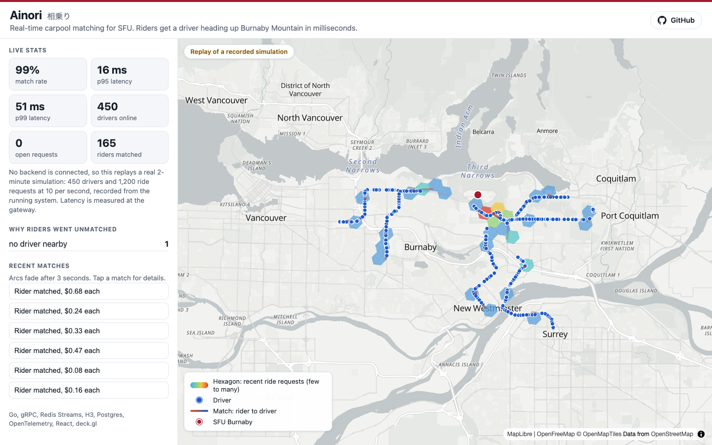
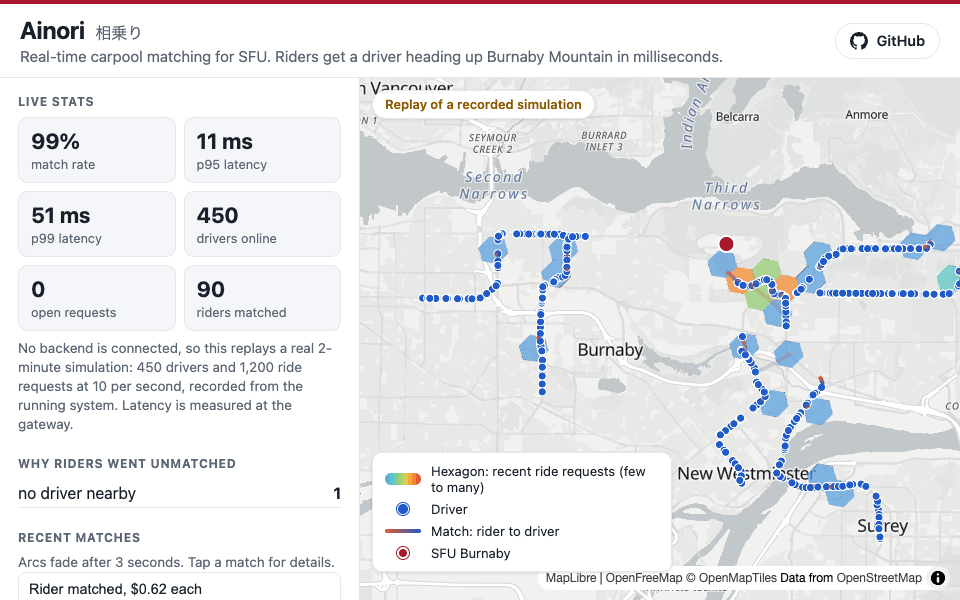
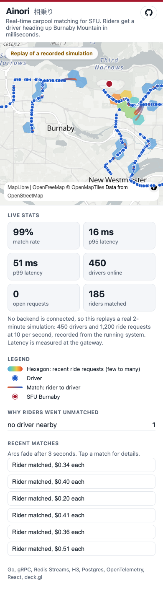

# Ainori

Ainori (相乗り, Japanese for "sharing a ride") matches SFU students driving up Burnaby Mountain with riders near their route, in real time. A rider asks for a seat, the system picks the best driver in a few milliseconds, and a live map shows it happen.

It is a set of small Go services in the style of Uber's architecture: H3 hexagon indexing, an event stream between services, gRPC for internal calls, and distributed tracing.

**Live demo:** LIVE_DEMO_URL_PLACEHOLDER (the hosted page has no backend, so it replays a real recorded simulation)







## How it fits together

```
 Browser map (React + deck.gl)
      ^  WebSocket                    REST
      |                                |
  +---+--------------------------------v---+
  |               gateway                  |
  +--+----------------+--------------------+
     | gRPC            | XADD stream:ride_requests
     v                 v
 +----------+      +------------------+   consumer group
 | location |      |  Redis Streams   |-------------------+
 | service  |      +------------------+                   v
 +----+-----+                                   +------------------+
      | H3 cell sets, driver hashes             | matching service |
      v                                         | filter, score,   |
 +----------+   gRPC NearbyDrivers              | Lua seat claim   |
 |  Redis   |<----------------------------------+ then Postgres    |
 +----------+                                   +--------+---------+
                                                         | XADD stream:matches
 sim CLI -> gateway (hundreds of drivers/riders)          v
 All services -> OpenTelemetry -> Jaeger          gateway -> WebSocket
```

1. **Drivers ping their position.** The location service turns it into an H3 hexagon and files the driver under it in Redis.
2. **A rider requests a seat.** The gateway saves the request, puts it on a stream, and answers right away with a request ID.
3. **The matcher picks it up.** It asks the location service for drivers in the rider's hexagon and the rings around it, drops drivers who are full, clash on the women/non-binary-only setting, or would get the rider to class less than 10 minutes early, and scores the rest by detour and pickup distance.
4. **It claims a seat with a Lua script.** The check and the decrement happen in one atomic step, so two riders can never take the last seat.
5. **It saves the trip and announces it.** Postgres gets the trip, the match goes on `stream:matches`, and the gateway pushes it to the browser. Only then is the request acknowledged, so a crash means the request is retried, not lost.

## Run it

You need Go, Docker, Node 22, and `buf` (only if you change the `.proto` files).

```
cp .env.example .env
make infra          # Redis, Postgres, Jaeger, and the migrations
make build          # builds bin/location, bin/matching, bin/gateway, bin/sim
```

Start each service in its own terminal (set `OTLP_ENDPOINT=localhost:4317` first if you want traces in Jaeger at http://localhost:16686):

```
./bin/location
./bin/matching
./bin/gateway
```

Load test and map:

```
./bin/sim --drivers 200 --riders 600 --rate 10     # saves a report in reports/
cd web && npm install && npm run dev                # http://localhost:5173
```

The "Run demo" button on the map starts a small 2-minute simulation.

### Live mode and replay mode

The map tries to connect to a backend (`VITE_API_URL`, or `localhost:8080` in dev). If none is reachable, such as on the hosted Netlify site, it replays `web/public/demo/recording.json` on a loop and shows a "Replay of a recorded simulation" badge. If a backend comes up later, the map switches to live data.

The recording is a real run: 450 simulated drivers and 1,200 ride requests at 10 per second, every WebSocket event saved with its timestamp. To record a new one, start the three services, then:

```
cd web && node scripts/record.mjs 140 public/demo/recording.json &
cd .. && ./bin/sim --drivers 450 --riders 1200 --rate 10 --seed 42
```

The latency numbers shown on the replayed map are measured at the gateway during that recording. They are not the benchmark numbers in `RESULTS.md`, which come from the simulator's own clock.

### Deploying the frontend

`netlify.toml` builds `web/` and publishes `web/dist`. With no `VITE_API_URL` set, the site runs in replay mode.

## Tests

```
make test       # go vet and go test -race against real Redis and Postgres
make web-test   # Vitest and a production build
```

Tests need `make infra` running. They use Redis databases 13 to 15, so they do not touch dev data on database 0.

## Results

See `RESULTS.md`. Short version: 200 drivers and 600 riders on one laptop, p99 match latency 33.7 ms at 10 req/s and 31.5 ms at 25 req/s, from the saved reports in `reports/`.

## Design decisions worth knowing

- **Redis Streams instead of Kafka.** Same pattern (append-only log, consumer groups, acknowledgements, reclaim of stuck messages) with no extra infrastructure. It sits behind a small `bus` interface, so Kafka would be one new adapter file.
- **At-least-once delivery plus idempotency.** The request row in Postgres stores the outcome, so a redelivered message re-publishes the same result instead of matching twice.
- **If saving the trip fails after the seat is claimed,** the seat is given back and the message is retried.
- **Travel time is a simple estimate** (`haversine * 1.3 / 40 km/h`). A real system would use road routing and traffic.
- **Trace context rides inside stream messages** as a `traceparent` field, so one Jaeger trace covers the whole request.

## Not built

Recurring rides, a Grafana dashboard (the `/metrics` endpoints exist), a hosted backend (the Netlify site shows a recording), and a Docker image for the Go services. A GitHub Actions workflow is in `.github/workflows/ci.yml` but has not been run on GitHub yet.

## Layout

```
cmd/            location, matching, gateway, sim, routegen (one-off route fetcher)
internal/       bus, geo, location, matching, cost, store, gateway, sim, telemetry, ids
proto/          gRPC contracts, generated into gen/ with buf
migrations/     SQL schema
data/routes/    7 real driving routes to SFU (GeoJSON, fetched once from OSRM)
web/            React, TypeScript, deck.gl map, plus scripts/record.mjs and the replay recording
docs/           README screenshots and demo GIF
reports/        saved simulator reports
```
